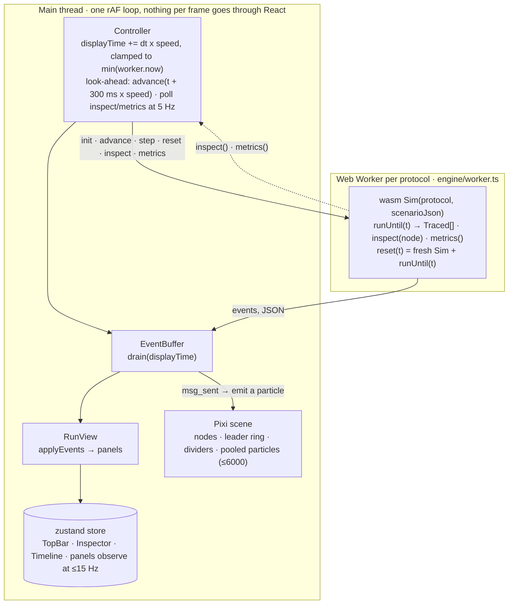

# Solana Consensus Lab: web front end

Interactive, pedagogical animation of how a transaction moves through Solana consensus
under **TowerBFT** and **Alpenglow**. The UI never simulates anything: it drives the Rust
engine (`crates/sim-core`) compiled to WebAssembly and renders the trace events it emits.

## Requirements

- [bun](https://bun.sh) ≥ 1.1 (package manager and script runner; do not use npm/npx)
- Rust toolchain + `wasm-bindgen` to (re)build the engine (`bash ../scripts/build-wasm.sh`)

## Develop

```sh
bash ../scripts/build-wasm.sh    # once, or whenever crates/ changes → web/src/wasm/pkg/
bun install
bun run dev                      # http://localhost:5173
```

## Build & deploy

```sh
bun run build                    # tsc (strict, zero errors) + generate guides + vite → web/dist/
bun run build:content            # just regenerate the written guides into web/public/
bun run preview                  # serve the production build locally
```

`vite.config.ts` sets `base: './'`, so `web/dist/` can be copied as-is to GitHub Pages
(or any static host / sub-path). The wasm binary is served as a plain asset and loaded
inside the Web Worker via `fetch`, so no special headers are needed.

### `vercel.json` holds data only, and that is deliberate

Two separate rules have each failed every deployment since `58b5eee`, and neither was
visible without attempting one. The last good deployment predates the `headers` block, which
is why production served an empty `<div id="root">` and 404ed on `/lessons.html` while
`main` built all of it correctly.

**No `"//"` comment keys.** Vercel's schema sets `additionalProperties: false` on a
`headers[]` item, allowing only `source`, `headers`, `has` and `missing`. A `"//"` key is
an additional property, and the deployment dies before the build runs. Vercel reports it as
`headers[0] should NOT have additional property '/'`. The same applies to `functions[*]`.

**`source` is path-to-regexp, not RegExp.** Vercel parses it with path-to-regexp v6.1.0,
which rejects capturing groups. The single pattern that used to cover every generated page
was written in RegExp and failed with `Capturing groups are not allowed at 2`, surfaced as
[`invalid-route-source-pattern`](https://vercel.link/invalid-route-source-pattern). Fixing
only the comment keys exposed this one, which is why `test/vercelConfig.test.ts` parses
every source with the same library and version Vercel documents.

The rules, and the reasoning:

- **`/assets/(.*)` is immutable.** Vite fingerprints everything under `/assets`, so those
  URLs cannot change meaning. Without this the 1.7 MB wasm and the 1 MB JS bundle are
  revalidated on every cold load, which is most of the app's Core Web Vitals problem.
- **The generated pages are not.** `/lessons.html`, `/protocols.html`,
  `/tower-vs-alpenglow.html`, `/lessons/<id>.html`, `sitemap.xml` and `robots.txt` are
  written by `build:content` (or tracked, for `robots.txt`), so caching them immutably
  would mean an edit to lesson copy never reaches anyone. `index.html` is the same case:
  its prerendered shell changes whenever the lesson copy does.
- **They are four rules, not one,** because path-to-regexp has no alternation. The test
  asserts coverage against the paths the build actually emits, so a rule that is valid but
  matches nothing fails locally rather than quietly mis-caching in production.

If you want a comment next to a value, put it here rather than in the JSON.

## Written guides (what a crawler sees)

The app is a client-rendered SPA with no SSR, so on its own it presents one URL with an
empty body to anything that does not execute JavaScript. Two things fix that, and both are
part of the normal build:

- **A prerendered shell.** `index.html` puts an `<h1>`, the headline numbers and links to
  the guides inside `<div id="root">`. React 18's `createRoot().render()` destroys the
  container's existing children on its first commit, so the app replaces all of it on mount
  with no hydration branch, and nothing is left underneath the canvas. Keep that block short
  and free of time-dependent wording: with scripting off, every word on it must stay true.
- **Generated guides** (`scripts/build-content.ts`), plain HTML with no script at all:
  `/tower-vs-alpenglow.html`, `/lessons.html`, `/lessons/<id>.html` per lesson,
  `/protocols.html` and `/sitemap.xml`. They are written into `web/public/` so the dev server,
  the production build and the e2e suite all serve the same bytes.

Their content is derived, never retyped: lesson pages import `LESSONS` from `src/lessons`, the
comparison page reads its numbers out of the results table in `README.md`, and the protocol
reference is `docs/protocols.md`. Edit the source and the page changes with it on the next
build. Generated files are gitignored.

Relative links throughout, because `base: './'` has to keep working from a Pages sub-path;
canonicals and the sitemap are absolute and point at the Vercel deployment, which is the
canonical copy.

`test/content.test.ts` covers the builders (every page has a title, description, canonical,
`<h1>` and valid JSON-LD; no block nested inside a `<p>`; every cross-link resolves and stays
relative). `e2e/seo.spec.ts` re-checks all of it over HTTP with `javaScriptEnabled: false`,
which is the only honest way to assert on what a crawler receives.

## Test

```sh
bun run test                     # vitest: event buffer, interpolation, tx stages, URL state, triggers, markdown, lesson registry, page titles, generated guides
bunx playwright install chromium # once
bun run e2e                      # Playwright (starts the dev server itself); also runs in CI
```

If `bun run e2e` fails on GA4, check for a stale dev server first: `reuseExistingServer` in
`playwright.config.ts` adopts one already on :5173, and it would have started without the
`VITE_GA_ID` the analytics specs assert on.

- `e2e/smoke.spec.ts` loads the page, selects `happy-path`, plays at 20× and asserts the
  Transaction panel shows a finalized time for Alpenglow, then writes `e2e/screenshots/happy-path.png`.
- `e2e/compare.spec.ts` does the same for `leader-down` in Compare mode.
- `e2e/lesson.spec.ts` follows the *Skip certificates* lesson end to end: intro, auto-run step,
  predict → run → reveal, Back to a recorded stop, outro, finish.
- `e2e/share.spec.ts` opens a share link, checks every field was restored, and reads the link
  the Share button copies to the clipboard.
- `e2e/keyboard.spec.ts` covers the keyboard contract: Space presses a focused control instead of
  starting playback, a dialog traps focus and closes on Escape, every Tab stop has a visible focus
  ring, and Space on a lesson card opens that lesson.
- `e2e/responsive.spec.ts` is the layout guard: the top bar and inspector fit 1440/1366/1280/1200/1024,
  the events feed fills its panel, and the app stays usable at 1024/900/768/390 instead of clipping.
- `e2e/timeline.spec.ts` asserts the bands render once, the playhead tracks a scrub and does not
  drift while paused, and stage markers still appear as the run reaches them.
- `e2e/node-picker.spec.ts` covers the keyboard node picker and the canvas's accessible name, and
  that an impossible `?node=` from the URL is dropped rather than left dangling.
- `e2e/tooltip.spec.ts` holds the toolbar's hover/focus names: every icon-only control describes
  itself, the tooltip sits under the control, it cannot swallow clicks, and Escape dismisses it.
- `e2e/seo.spec.ts` runs with JavaScript disabled and asserts what a crawler actually gets: the
  prerendered shell on `/`, every generated guide served with a title, description, canonical,
  `<h1>` and JSON-LD, every cross-link between them returning 200, and a sitemap whose every URL
  resolves. It also checks the counterpart, that React replaces the shell once it mounts.

The Playwright viewport is 1440x900, so `responsive.spec.ts` is the only thing that exercises a
narrow window. `smoke.spec.ts` and `compare.spec.ts` rewrite the tracked screenshots on every run;
expect `git status` to show them as modified after a local `bun run e2e`.

## Architecture



One worker per protocol (`alpenglow`, `tower`); `engine/protocol.ts` is the exact `postMessage`
request/reply union.


Key ideas:

- **One display clock, N workers.** Compare mode runs an Alpenglow worker and a Tower
  worker from the same scenario JSON and seed; both are driven by the same
  `displayTime`. The clock never outruns a worker; it stalls instead of skipping events.
- **Time-indexed event buffer** (`engine/eventBuffer.ts`). Workers pre-compute ~300 ms
  (× speed) of sim time ahead. Each frame the controller *drains* the events whose `t`
  has been passed by the display clock; those events (and only those) update the derived
  `RunView` used by the panels and spawn particles. Panels therefore always agree with the
  canvas about "now".
- **Scrubbing.** Forward: the clock jumps, buffered events drain, particles already
  arrived are skipped (`isVisibleAt`). Backward: the worker re-creates the Sim and
  fast-forwards to the target (`reset`); the main-thread buffer and view are rebuilt from
  the returned events, again suppressing particles that would already have landed.
- **Particles** (`render/particles.ts`) are pooled `Particle`s in Pixi `ParticleContainer`s
  and no DOM per message. Position is a quadratic bezier (slight arc, always to the left of
  travel so both directions stay legible). Dropped messages fizzle at 60 % of the path.
  `prefers-reduced-motion` lowers the cap to 1500 and disables glow.
- **Colour** is reserved for message identity (shred blue, vote aqua, certificate gold,
  repair grey; the hero tx is a white glow). The palette was validated CVD-safe against
  the canvas surface with the dataviz validator; nodes stay neutral so traffic pops.
- **Breakpoints** (`engine/breakpoint.ts`, `Controller.setBreakpoint`). A lesson step names a
  declarative `Trigger`; each frame the controller computes the clock target, and *before*
  advancing scans `EventBuffer.range(displayTime, target)` of the watched run for the first
  matching event and clamps the target to its exact `t`. The stop is therefore frame-exact
  at any speed with no rewind. `time` triggers and `deadlineUs` clamp to an absolute time.
  While a run is `resetting` after a backward seek the clock is held.
- **URL state** (`url/state.ts`, `url/sync.ts`). `?scenario=…&seed=…&mode=…&t=<ms>&node=…&tab=…&speed=…&lesson=…&step=…`;
  a custom scenario is deflate-raw + base64url in `s=`. `App` hydrates the store from the URL
  before the first `configure()` and seeks to `t` once it resolves; `startUrlSync` mirrors the
  store back with a debounced `replaceState`, writing `t` only while the clock is paused.

The whole-project map (crates, engine loop, render pipeline, test map, limits) is
[`docs/architecture.md`](../docs/architecture.md); this section is the front end's own detail.

## Lessons

A lesson is a plain TypeScript object (`src/lessons/types.ts`) registered in
`src/lessons/index.ts`:

```ts
export const skipCerts: Lesson = {
  id: 'skip-certs', title: '…', summary: '…', minutes: 4,
  scenario: 'leader-down', mode: 'alpenglow', seed: 1, speed: 1,
  intro: `markdown…`,
  steps: [
    { id: 'offline', title: '…', protocol: 'alpenglow', trigger: { type: 'node_offline' }, body: `…` },
    { id: 'skip-cert', title: '…', protocol: 'alpenglow', trigger: { type: 'certificate', kind: 'skip' },
      tab: 'votor', selectNode: 'hit',
      lead: `shown before the run`, question: { prompt, choices, answer, explain }, body: (hit, view) => `…` },
  ],
  outro: `markdown…`,
};
```

- `trigger` is one of the `Trigger` variants in `engine/breakpoint.ts` (`tx_stage`, `certificate`,
  `pool_event`, `votor_flag`, `timeout`, `node_offline`, `partition_start/end`, `block_produced`,
  `tower_update`, `commitment`, `log`, `time`). `deadlineUs` stops anyway if it never fires.
- `body` may be a function of the hit event and the run's `RunView`, so copy can quote the
  actual slot, stake or metric. `lead` is shown before the stop; a step without a `question`
  runs as soon as it is entered.
- Text is a small markdown subset (`lessons/markdown.ts`): paragraphs, `## ` headings,
  `- ` bullets, `**bold**`, `` `code` ``, `[text](url)`, and GFM tables (needed by
  `docs/protocols.md`, which is published as `/protocols.html`). Single `*asterisks*` are
  deliberately **not** italic: `markdown.test.ts` pins them to plain text, so any lesson copy
  that wants emphasis must use `**bold**`.
- `lessons/runner.ts` drives the store and controller; `components/LessonPanel.tsx` renders the
  left column. `test/lessons.test.ts` checks every lesson's scenario exists and steps are well-formed.
- Adding a lesson also adds a page: the generator walks `LESSONS`, so `bun run build:content`
  emits `/lessons/<id>.html` and adds it to the sitemap with no further wiring.
- Verify timings with the CLI before writing copy, e.g.
  `cargo run -p sim-cli -- run --scenario leader-down --protocol alpenglow --events 100000 --only certificate,pool_event`.

### Files

```
src/
  engine/   types.ts (contract mirror) · protocol.ts · worker.ts · client.ts
            eventBuffer.ts · txStages.ts · controller.ts · breakpoint.ts · wasmMain.ts
  render/   colors.ts · layout.ts · interp.ts · particles.ts · scene.ts · CanvasView.tsx
  store/    useStore.ts (zustand) · runView.ts (event → view reducer)
  url/      state.ts (parse/format/compress) · sync.ts (store ⇄ address bar, share link)
  util/     format.ts (µs/ms/bytes) · pageTitle.ts (per-state document.title)
  lessons/  types.ts · markdown.ts · runner.ts · index.ts · one lesson per file
  components/ Brand (the project mark, traced from SCL-logo.png) · TopBar (incl. ClockReadout) · Timeline
              Inspector (incl. NodePicker) · Modal · ScenarioModal
              LessonPanel · LessonPicker · Markdown
              panels/ Transaction · Votor · Tower · Events · Metrics
              charts/ TallyBar · LockoutBars · ForkTree · StatTile
test/     vitest unit tests        e2e/  Playwright specs + screenshots
scripts/  build-content.ts (writer) · content/pages.ts (the pages) · content/render.ts (escaping, shell, sitemap)
```

### Contract notes (docs/wasm-api.md vs actual bindings)

- `builtinScenario(name)` returns `string | undefined` (doc: `string`).
- Under Tower, `block_produced.txs` does not include the hero tx id, so the UI derives the
  hero block from the `tx_stage: included_in_block` event's slot instead. `vote_txs` on the
  same event is the count of vote transactions packed (0 under Alpenglow).
- `Sim.protocol()` exists in the bindings but is undocumented.
- `inspect(node).pool` (Alpenglow) contains `null` entries for slots the node holds no
  tally for; the UI filters them. Tower `inspect().forks` entries carry extra `leader` and
  `replayed` fields.
- `certificate.stake_pct` is a fraction (0–1) while pool tallies use percent (0–100).
- `hash` values are u64 serialised as JSON numbers, so they lose precision past 2^53 and
  their low hex digits come out as `000`. The UI compares them for equality only and shows
  the *leading* 4 hex digits (the doc suggests the trailing 4, which are all zeros).
- `metrics()` is computed over everything the worker has produced, i.e. up to ~300 ms
  (× speed) ahead of the display clock.
